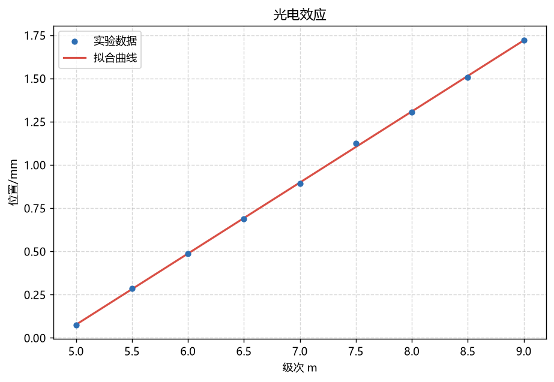

# 光电实验数据处理助手

> 面向光电专业本科实验的一站式本地工具：
>
> **公式计算・数据拟合・不确定度评定・实验报告生成**
> 物光创新实验室 2026 招新作品

本项目解决一个真实痛点：光电专业学生在大学物理实验、光电实验中经常需要重复做四件事 —— 查光学公式手算、用 Excel / 手工拟合数据、按教材步骤评不确定度、最后手动拼一份实验报告。本工具把这四步整合到一个本地网页应用中，粘贴数据即可完成全部处理并一键导出 Word 报告。





***

## ✨ 功能特性


| 功能页       | 说明                                                                                                     |
| --------- | ------------------------------------------------------------------------------------------------------ |
| **公式计算器** | 内置 14 个光电基础公式（薄透镜、折射定律、光栅方程、杨氏双缝、单缝衍射、光子能量、瑞利判据、数值孔径、布儒斯特角、全反射临界角、透镜组、放大率、朗伯 - 比尔定律等），任意缺一项自动求解，单位自动换算 |
| **数据拟合**  | 线性拟合（给出斜率 / 截距及其不确定度、R²）、多项式拟合、自定义函数拟合（Levenberg-Marquardt 算法），自动绘图并支持误差棒、可下载 PNG                      |
| **误差分析**  | A 类不确定度（t 因子表，95%）+ B 类（Δ/√3）合成评定；任意函数误差传递（自动数值求偏导）                                                    |
| **报告生成**  | 一键生成标准格式 Word 实验报告（.docx），包含信息表、数据表、拟合结果、拟合图、不确定度、结论，可直接编辑                                             |

**技术亮点（可在面试中介绍）**


* 自定义函数拟合为**纯 numpy 实现的 Levenberg-Marquardt 算法**（不依赖 scipy），体现算法理解；

* 公式、拟合、误差、报告四层完全解耦，新增一个公式只需十几行代码；

* 全部本地运行，数据不上传，适合课堂与实验室使用。


***

## 🚀 快速开始

### 环境要求


* Windows 10/11（macOS / Linux 也可，命令略有差异）

* Python 3.10+（本项目在 3.14 下验证通过）

### 方式一：双击运行（推荐，Windows）

双击项目根目录的 `run.bat`：


* 首次运行会自动创建虚拟环境 `venv/` 并安装依赖（需联网，约 2\~5 分钟）；

* 之后自动启动并打开浏览器 `http://127.0.0.1:7860`。

### 方式二：手动运行


```
# 1. 创建并激活虚拟环境（可选但推荐）
python -m venv venv
venv\Scripts\activate          # Windows
# source venv/bin/activate     # macOS / Linux

# 2. 安装依赖
pip install -r requirements.txt

# 3. 启动
python app.py
```

启动后浏览器自动打开界面；若未自动打开，手动访问 `http://127.0.0.1:7860`。

### 验证安装是否成功


```
python self_test.py
```

全部输出 `[PASS]` 即表示环境与代码正常（共 28 项检查）。


***

## 📖 使用说明

### 页面一：公式计算器


1. 下拉选择公式（如 “薄透镜成像公式”）；

2. 填写已知物理量，**留空一个待求量**；

3. 点击「计算」，下方输出结果（含单位与换算说明）。

> 例：薄透镜，物距 u = 20，像距 v = 30，留空焦距 f → 得 f = 12 cm。
> 每个公式下拉后都有示例输入提示。

### 页面二：数据拟合


1. 粘贴数据，每行一组：`x, y` 或 `x, y, dy`（dy 为 y 的误差，可画误差棒）；

   分隔符支持逗号 / 空格 / 制表符；首行可写表头（自动跳过）；

2. 选择拟合方式：

* **线性**：直接输出 k、b 及各自不确定度、R²；

* **多项式**：调整阶数；

* **自定义**：写 Python 风格表达式，参数自动识别（如 `a*exp(-b*x)+c`），初值可留空；

1. 点「开始拟合」，结果文本 + 曲线图同时输出，可下载 PNG。

### 页面三：误差分析


* **直接测量不确定度**：粘贴多次测量值（每行一个）+ 仪器允差 Δ → 输出平均值、A/B 类、合成与扩展不确定度；

* **误差传递**：输入表达式与各变量（每行 `变量名 = 数值, 不确定度`），自动求偏导合成。

  例：表达式 `u*v/(u+v)`，变量 `u = 12.3, 0.2`、`v = 30.0, 0.4`。

### 页面四：报告生成


1. 填实验名称、姓名、学号、班级等基本信息（实验目的 / 原理 / 仪器可留空，生成后用 Word 补）；

2. 粘贴实验数据，选择拟合方式；

3. （可选）粘贴重复测量数据用于不确定度分析；

4. 点「生成实验报告」→ 下载 .docx 即可编辑。

### 页面五：使用帮助

内置本说明的速查版。


***

## 📂 示例数据

`examples/` 目录提供三组基于真实物理参数、带随机误差的模拟数据（由 `examples/generate_samples.py` 生成，可复现）：


| 文件           | 物理背景                         | 拟合预期                 |
| ------------ | ---------------------------- | -------------------- |
| `杨氏双缝干涉.csv` | 钠黄光 λ=589.3nm，L=1.0m，d=0.5mm | 斜率 ≈ 1.179 mm        |
| `单缝衍射.csv`   | He-Ne 激光 λ=632.8nm，a=0.1mm   | 斜率 ≈ 6.328 mm        |
| `光电效应.csv`   | h/e=4.136e-15 V・s，逸出功 2.0 eV | 斜率 ≈ 0.414，截距 ≈ -2.0 |

在 “数据拟合” 页上传任一 CSV 即可体验完整流程。


***

## 🗂 项目结构


```
光电实验数据处理助手/
├── app.py                    # 主程序：Gradio 界面（5 个功能页）
├── self_test.py              # 自检脚本：28 项自动验证
├── smoke_test.py             # 界面冒烟测试（启动服务 → 校验页面）
├── run_demo.py               # 示例数据拟合演示脚本
├── requirements.txt          # 依赖清单
├── run.bat                   # Windows 一键启动
├── README.md                 # 本文件
├── core/                     # ★ 核心算法库（与界面解耦，可单独使用）
│   ├── formulas.py           #   14 个光学公式
│   ├── fitting.py            #   数据拟合（线性/多项式/自定义）
│   ├── uncertainty.py        #   不确定度评定 + 误差传递
│   └── report.py             #   Word 实验报告生成
├── docs/
│   ├── 设计制作流程与修缮指南.md   # ★ 开发思路与二次开发手册
│   └── demo_*.png            # 示例拟合效果图
└── examples/
    ├── 杨氏双缝干涉.csv
    ├── 单缝衍射.csv
    ├── 光电效应.csv
    └── generate_samples.py   # 示例数据生成脚本
```


***

## 🧠 设计思路（一句话版）

**界面与算法分离**：`core/` 只做纯计算、不依赖界面，`app.py` 只做交互、不写算法。这样任何一处改动都不影响另一处，也方便把 `core/` 当普通 Python 库在脚本 / Jupyter 里直接用。

详细设计（架构图、模块解读、从零开发流程、二次开发示例、面试讲解点）见 [docs / 设计制作流程与修缮指南.md](docs/设计制作流程与修缮指南.md)。


***

## ❓ 常见问题（FAQ）


| 问题             | 解决方法                                                                                    |
| -------------- | --------------------------------------------------------------------------------------- |
| 双击 run.bat 没反应 | 右键 → 编辑，确认第一行 `cd /d "%~dp0"` 存在；或在命令行手动执行 `python app.py`                              |
| 端口 7860 被占用    | 修改 `app.py` 中 `server_port=7860` 为其他端口（如 7861）                                          |
| pip 安装很慢 / 失败  | 换国内镜像：`pip install -r requirements.txt -i https://pypi.tuna.tsinghua.edu.cn/simple`     |
| 图表中文乱码         | 本工具已内置微软雅黑回退；若仍异常，在 `core/fitting.py` 的 `plt.rcParams["font.sans-serif"]` 中补充你系统已有中文字体名 |
| 自定义拟合不收敛       | 检查表达式与参数个数；在 “参数初值” 中给出接近真实值的初值（如 `1, 0.1, 1`）                                          |
| 上传 CSV 打开乱码    | 用记事本另存为 UTF-8；或直接在输入框粘贴内容                                                               |


***

## 📜 开源许可

本项目使用 **MIT License**，代码可自由使用、修改与分发。

部分公式与 t 因子表参考大学物理实验教材，属公共知识；示例数据为程序模拟生成，无版权问题。


***

## 🙋 作者

物光创新实验室 2026 招新作品・作者：〔你的姓名〕

GitHub：〔你的仓库链接〕